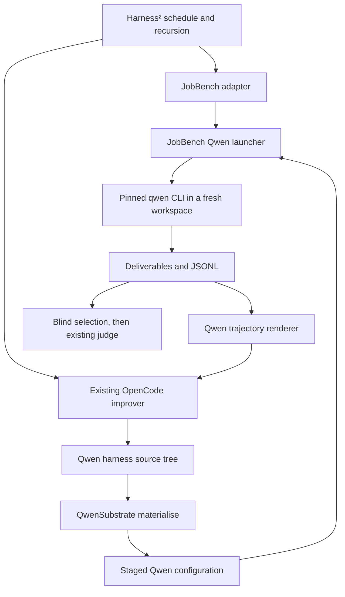

# Qwen Code executor integration

[中文](qwen-code.zh-CN.md)

Status: experimental implementation available; real Linux JobBench validation remains pending. Designed on 2026-10-20 and updated on 2026-10-21 against Harness² `1cfe254e8d25b15f37048c3730134686abe60335`.

Implementation notes: the pinned npm CLI has passed local mock-model tests for skills/helpers, hook denial/feedback, JobBench artifact collection and resume. Deterministic JobBench-shaped tasks cover both recursion modes at k=1/2, budgets, selection, reflection and library reuse. These are compatibility tests, not live benchmark results. Runtime policy support is deliberately limited to empty or UI/telemetry-only strict JSON system settings; configured policy paths must be absolute. The runner initializes an empty Git project with no templates to stop ancestor context discovery. Skill frontmatter is limited to name/description. See [setup](../SETUP.md#qwen-code-executor-experimental) for usage.

## 1. Decision and evidence

The generated `.qwen/.env` terminates ancestor dotenv search, separately from the Git context boundary. Legacy home dotenv files with settings cause preflight to fail. Runtime, MCP approval and trust paths are bound to the attempt's private home before startup; personal files remain outside the installation.

Add `--substrate qw` as a Qwen Code task executor. Deliver JobBench first, with the existing OpenCode improvement channel. Keep the recursive algorithm, blind selection, reflection, grading and experience-library semantics.

The first release exposes c1–c4, c6, c7 and a restricted c8. c5 subagents are deferred. LAB, WorkBuddy, a Qwen improvement channel, OAuth, ACP/daemon integration and general OpenCode plugin compatibility are separate follow-ups.

Evidence available today:

| Item | Observed result | Limit |
|---|---|---|
| Local test suite | All 16 tests passed under Python 3.12: 5 existing workflow tests, 9 Qwen behavior tests and 2 opt-in published-CLI tests | Local execution and simulated models; real Linux/live-model acceptance remains pending |
| Published `@qwen-code/qwen-code@0.25.3` | Installed with the pinned integrity; loaded memory, appended instructions and a skill/helper; exercised hook denial/feedback, tool-result round trips, deliverables and adapter resume | A real CLI process with a local mock OpenAI endpoint; no benchmark score improvement established |
| Qwen source | CLI and configuration contracts examined at `e715a1af9ecd2aad4543b63d8bb2dd335e31ca04` | Runtime support is pinned to the tested npm package; other CLI builds require their own verification |

Local verification covers terminal failure, hook blocking, isolation and process cleanup. Linux deployment and paid model execution remain acceptance work.

## 2. Ownership



| Owner | Responsibility |
|---|---|
| Method | Proposal/probe/composition budgets, selection, reflection and earlier-task-only library access |
| `QwenSubstrate` | Editable surface, materialisation, launch arguments/environment, protocol parsing and executor preflight |
| JobBench adapter/launcher | Task inputs, workspace, prompt, time limit, output collection and completion validation |
| Deployment | Pinned CLI/Node, endpoint credentials, effective system policy and network configuration |
| Judge | Existing rubric evaluation after selection; no verdicts enter improvement context |

Use the existing `Substrate` protocol. The launcher remains supplied by the benchmark. Do not add a new framework-wide executor registry or change the algorithm for this integration.

## 3. Editable harness and installation

### Source tree

```text
systemprompt.md
guardrails.md
LongTermMEMORY.md
tool_descriptions/tool_guidance.md
.qwen/skills/<name>/SKILL.md
.qwen/skills/<name>/scripts/<helper>
scripts/<name>.py
.qwen/hooks.json
```

`sub_agents/<name>/AGENT.md` stays unavailable in phase 1. It is rejected through `BenchSpec.allow_subagents=False`; the launcher also excludes delegation tools.

Proposed `QWEN_SURFACE` values:

| Field | Value |
|---|---|
| `name` | `qwen`; the executor's namespace token is separately `qw` |
| `always_on` | The four Markdown files above, in the listed order |
| `always_on_max` | 24,000 characters across those files, including separators; a harness budget, not a Qwen context-window limit |
| `skill_dir` / `skill_name_rule` | `.qwen/skills` / `must_match` |
| `autotrigger_file` | `guardrails.md` |
| `trigger_line` | `- When {desc}, use the skill tool to load {name}.` |
| `plugin_dir` | `None` |
| `hooks_file` / `hook_events` | `.qwen/hooks.json` / `PreToolUse` and `PostToolUse` |
| `compile_skill_scripts` | `True` |
| Install mode | New `qwen_root` |

The first JobBench baseline has a minimal instruction to follow the task and save final deliverables in the specified output directory; the other always-on files are empty. It has no added skills, scripts or hooks. Generate this deterministic source tree when requested, following the existing LAB baseline pattern. Dry-run must not create it.

### Native mapping

| Component | Installation |
|---|---|
| c1 `systemprompt.md` | Read from a generated `.harness2/append-system-prompt.md` and pass its text to `--append-system-prompt` |
| c2 guardrails, c3 memory, c4 tool guidance | Render into root `QWEN.md`, with stable headings and order |
| c6 skills and skill helpers | Copy under `.qwen/skills/`; explicitly enable the source tree's skill names |
| c7 scripts | Copy under `scripts/` |
| c8 command hooks | Validate `.qwen/hooks.json`, then merge only its `hooks` object into generated `.qwen/settings.json` |

Retain Qwen's built-in prompt. `systemprompt.md` is supplemental in this version, consistent with the JobBench OpenCode baseline's supplemental instructions. Full replacement via `--system-prompt` or `QWEN_SYSTEM_MD` is outside phase 1. No implicit template interpolation occurs in Qwen source files.

Generated `QWEN.md`, `.qwen/settings.json`, the append-prompt file and installation manifest are not editable source paths. Credentials, model, tool restrictions, trust and time limits are outside the proposal's settings interface and are supplied by the launcher. This interface restriction does not make arbitrary proposed scripts a security boundary. `Install.fingerprint` continues to digest the source tree, excluding generated files.

Materialisation is deterministic for a source tree and a fixed runtime profile. The staged installation manifest records a profile version and generated-content digest, without secrets or temporary absolute paths. Use a versioned runtime profile for changes to rendering or fixed defaults.

### Validation and prompt text

Reuse shared path, Python compilation, skill-name/description/trigger and hook-envelope checks. Add Qwen-specific validation in `QwenSubstrate.materialise`, also called by `JobBenchAdapter.validate_tree`, so invalid proposals receive feedback before execution.

Only c8 `command` hooks are initially accepted. Allow event matcher entries and `type`, `command`, `timeout` fields; reject extra top-level settings, other hook types and async hooks. Set an omitted timeout to 10 seconds; accept explicit values from 1 to 60 seconds. Commands use actual Qwen tool names such as `write_file` and `run_shell_command`. The same process time limit still applies to the whole rollout.

A PostToolUse observation is not proof that blocking semantics work. PreToolUse denial and PostToolUse feedback must pass real-CLI tests against the pinned package before c8 is advertised as supported. Hook scripts must be shipped as editable scripts; do not depend on files from the author's machine.

Add a dedicated `qwen` entry to `core/prompts.py`, including both existing `adapt` and `tts` prompt-pack descriptions. Its edit instructions must describe these paths, supplemental prompt semantics, actual skill invocation, available hook events and the unavailable c5. Aliasing the Codex/OpenCode prompt descriptions would teach the improver the wrong format.

## 4. Runtime profile

### Configuration

| Proposed setting | Meaning |
|---|---|
| `HARNESS2_QWEN_MODEL` | Exact model ID accepted by the Qwen executor endpoint; passed unchanged, including any slash |
| `HARNESS2_QWEN_BASE_URL` | Explicit OpenAI Chat Completions base URL, including its API path |
| `HARNESS2_QWEN_API_KEY` | Executor credential; forwarded only in the child environment as `OPENAI_API_KEY` |
| `HARNESS2_IMPROVER_MODEL` | Existing OpenCode `provider/model` ID; required explicitly when no OpenCode solver default is configured |
| `HARNESS2_JUDGE_MODEL` and existing judge settings | Unchanged |
| `HARNESS2_RUNS_DIR` | Existing experiment root |

Do not silently derive the Qwen model or credentials from OpenCode/Codex settings or the user's Qwen installation. Validate HTTP(S) URL syntax and reject userinfo, query strings and fragments to keep credentials out of run identity and logs. The exact normalised URL used for launch is also the one recorded.

`harness2-setup jb --substrate qw` installs `@qwen-code/qwen-code@0.25.3` under `dependencies/qwen/` and records package integrity. Require Node >=22 and execute this local binary, never whichever global `qwen` happens to be on PATH. Existing OpenCode setup remains necessary for the improver.

### Launch contract

The reference child invocation is an argument list, not a shell command:

```text
<local-qwen> --auth-type openai
  --model <HARNESS2_QWEN_MODEL>
  --openai-base-url <HARNESS2_QWEN_BASE_URL>
  --append-system-prompt <rendered c1 text>
  --output-format stream-json
  --approval-mode yolo
  --chat-recording=false
  --max-wall-time <rollout timeout>
  --sandbox=false
  --exclude-tools <fixed excluded tools>
```

Send the task prompt through stdin and close stdin after writing it. Omit the append flag if c1 is empty. Do not enable partial-message output, `--continue`, `--resume`, `--bare` or `--safe-mode`. Bare/safe mode would disable the harness being measured. Test the published package's exact flag syntax and stdin behavior.

Every attempt receives a fresh workspace and a fresh `QWEN_HOME` outside the repository and task inputs. Initialize an empty Git project with no templates to stop ancestor context discovery. Generate its minimal user settings, an exact-workspace trust entry in `trustedFolders.json`, and the project settings. Enable folder trust and trust only this generated workspace. Skip user, bundled and extension skill discovery with `skills.disabledLevels`; leave project discovery active and explicitly list staged skills in `skills.enabled`.

Freeze the phase-1 tool profile: exclude delegation/control tools (`agent`, `list_agents`, `send_message`, `task_stop`), scheduling tools (`cron_create`, `cron_delete`, `cron_list`, `loop_wakeup`, `monitor`), Goal tools (`get_goal`, `update_goal`), and worktree lifecycle tools (`enter_worktree`, `exit_worktree`). Keep ordinary file, shell, search and skill tools. Verify denial through the pinned CLI's registration/permission layer, including deferred tool lookup; record the exclusions in run identity.

Construct the child environment explicitly. Preserve necessary OS/runtime variables, the controlled PATH and intended deployment policy; clear inherited provider selectors, prompt overrides, Qwen runtime/trust path overrides and discovery paths. Bind only the chosen credential and per-attempt `QWEN_HOME`. Never copy personal OAuth tokens, extensions, MCP configuration or user settings.

Honor deployment system settings and configured system-policy paths. Do not replace those files with empty files to make a benchmark pass. Before the first paid call, check that effective policy permits the generated context, skills, hooks and required tools; otherwise fail with the conflicting source. Record the non-secret policy identity. A fresh home is not proof of policy isolation; test ancestor/global context canaries as well.

This profile follows the release's existing unattended, unsandboxed execution model. Fresh directories isolate experiment state; they are not a filesystem or network security boundary. Apply the existing benchmark egress policy separately.

## 5. JobBench execution and artifacts

The adapter retains task discovery, professions, leak globs, prompts, extraction, judging and reporting. It adds explicit `qw` dispatch in model, timeout, baseline, launcher and preflight selection. An unsupported `(lab, qw)` or `(wb, qw)` cell must fail before setup, subprocesses or model calls, with no Codex fallback.

The first launcher accepts one task/run ID, like the current JobBench adapter. Call the new first-party runner helper in process from the adapter; it directly owns the Qwen `Popen`. Do not wrap it in the existing detached shell-runner path and then give Qwen a second independent process group: killing only that wrapper could orphan the actual executor.

1. Create a fresh attempt; copy only the clean `task_folder/` inputs and the staged installation. Rubrics, expected answers and prior outputs stay out.
2. Use the existing JobBench task-prompt contract with this workspace's input/output paths.
3. Start the CLI in a new process session. Capture stdout JSONL and stderr separately.
4. Parse terminal status and collect the output files. Persist capture and status before deleting temporary workspace/home.
5. Return only after the completion predicate below passes. The adapter then atomically writes the existing completion marker.

Preserve the current store layout:

```text
runs/jb/dataset/<profession>/<task>/task_folder/
runs/jb/dataset/<profession>/<task>/model_output/<label>/...
runs/jb/dataset/<profession>/<task>/model_traj/<label>/
    qwen-output.jsonl
    qwen-stderr.txt
    qwen-status.json
    .adapt_complete
```

`model_output` contains only final deliverables. Diagnostics and configuration manifests must not be mistaken for deliverables or sent as task answers to the judge. `qwen-status.json` records protocol/profile versions, process exit, terminal result, timeout reason, elapsed time, tool-call validation and provider usage if available. Include the scrubbed installation manifest in its `install` field so it survives workspace cleanup. Missing USD cost stays unknown; the existing ledger must not be described as a complete executor bill.

### Completion and interruption

```text
PREPARED -> RUNNING -> CAPTURED -> COMPLETE
                |          |
                +----------+-> FAILED / TIMED_OUT / CANCELLED (unmarked)
```

A JobBench rollout is complete only when all conditions hold:

- The process exits 0 within its time limit.
- A terminal `result` reports `subtype=success` and `is_error=false`; the conversation and tool results are parseable, with no unresolved tool call.
- At least one actual final deliverable exists and is copied successfully.
- Capture/status are durable and the copied output fingerprint can be calculated.

Recovered tool errors inside a later successful session are valid evidence. A terminal error, malformed/truncated protocol, stdout banner alone, partial file, or successful exit without terminal success cannot establish completion.

On timeout/cancellation, send SIGTERM to the process group, wait up to 5 seconds, then SIGKILL remaining group members and reap the process. The parent enforces an outer limit including a small shutdown allowance; Qwen's wall-time flag is an additional bound. Keep diagnostics and partial artifacts for inspection, without a completion marker. Test hook subprocesses and shell descendants; process-group control does not guarantee containment of deliberately detached processes.

The Qwen runner module keeps a lock-protected set of active child processes and a cancellation event. Register each child before polling and unregister it only after reaping; no new launch is allowed after cancellation. The main-thread `qw` sweep scope handles SIGINT/SIGTERM and exception exit by cancelling/reaping owned Qwen groups, then restores the previous handlers and returns a nonzero interruption status. This is cleanup of Qwen-owned executions, not a redesign of other improvement-channel processes.

The launcher performs no automatic retry. Leave failed runs unmarked and use the existing rerun/resume behavior for a fresh attempt. Never continue an old Qwen session after a harness edit. Before rerolling, move prior capture/status and partial outputs under a sibling `_failed_attempts/<label>/<attempt>/` directory outside the active output/trajectory paths. Retain the latest three failed attempts per label; existing cleanup must not erase the only failure evidence.

## 6. Trajectory contract

Read newline-delimited events independently of JSON key order. Preserve original event ordering and capture, tolerate unrelated diagnostic lines, and record parse errors. Protocol corruption in conversation/tool/result records makes the run incomplete. Unknown nonterminal event types are retained and rendered as harness diagnostics; an unknown terminal result subtype is an error.

| Qwen event/block | Shared rendering |
|---|---|
| Assistant `text` | `[ASSISTANT]` |
| Assistant `thinking`, when emitted | `[REASONING]` |
| Assistant `tool_use` | `[ACTION] <name>: <input>` |
| User-message `tool_result` | `[OBSERVATION]` or `[OBSERVATION ERROR]`; correlated by `tool_use_id` |
| Genuine user task | `[USER]` |
| Init/config/system events | `[HARNESS]`, without presenting context/configuration as task instructions |
| Terminal `result` | Completion/error diagnostic, not a second assistant answer |

Use a tool-call-ID map for parallel calls. Deduplicate repeated final message IDs while retaining first-appearance position; do not discard distinct messages that have the same text. Partial messages are disabled in phase 1, so merging delta streams is unnecessary. Respect `obs_trunc`, `args_trunc` and `max_chars` with explicit truncation markers; preserve the raw capture.

The initial implementation and test fixtures must include recovered tool errors, multiple tool results, duplicate IDs, reordered JSON keys, unknown events and premature EOF. This parser is part of the run-success decision, not just a presentation helper.

## 7. Resume, identity and confidentiality

Keep `qw` in namespaces and library variants, for example `jb-qw-agg1` and `jb-qw-seq1`. Extend `run_sweep._check_identity` for `qw` only, preserving existing `oc/cx` identity JSON and resume behavior.

Record Qwen model, normalised endpoint, auth type, installed version/integrity, Node version, runtime-profile/protocol versions, effective policy fingerprint, fixed tool profile and baseline definition identity, together with existing task partition, seed, improver and judge fields. Do not include keys, access tokens, temporary paths or the whole environment.

The namespace identity gates both reused rollouts and the experience library before scheduling. The existing marker remains harness-specific and records the output fingerprint. Add the Qwen execution-identity digest and digests of the persisted capture/status to marker extras; direct adapter reuse must validate these even when bypassing the sweep entry point. An old `qw` marker lacking them is incomplete. Changes to model, endpoint, package, policy or runtime profile require a separate run root. Credential rotation alone is excluded from identity.

Only the adapter writes `.adapt_complete` after successful validation/collection. Read-back requires marker identity, validated status, intact capture and matching outputs. Missing or altered capture/output causes a reroll; a generated nonempty log is not a deliverable.

The wrapper never prints credential arguments or serialises the credential environment. Redact known credential values from persisted diagnostic captures and error messages; keep endpoint secrets out by validation. Credentials remain outside editable and improvement-context trees. This does not add a security sandbox around the executor.

## 8. Setup, preflight and intended commands

Add `qw` to the shared CLI choices and setup parser, with an explicit JobBench-only support check reused by check/run/judge/report. Do not create output or install tools during dry-run.

Qwen preflight checks the local package/version/integrity, Node, required flags, URL/key presence and effective settings/trust/tool profile without inference. Evaluate relevant scoped settings using the pinned precedence/deny rules; reject a configuration whose effect cannot be established instead of claiming it is ready. The real-CLI acceptance tests establish that the supported profile is actually loaded; preflight must not invent an unavailable CLI introspection flag. Keep OpenCode checks because the improver still uses it. Make model validation substrate-aware: a Qwen run requires the Qwen solver and a valid OpenCode improver, rather than an otherwise unused OpenCode solver. Judge requirements remain as today. Require Vertex/ADC only for an active Vertex-backed improver or judge, not for the Qwen route itself or an unused OpenCode solver setting.

Preflight is an offline readiness check, not proof that the endpoint accepts the account/model. Authentication, quota and model availability errors discovered by the first real request leave the rollout incomplete.

These commands are implemented for experimental JobBench use; live Linux acceptance is pending:

```bash
harness2-setup jb --substrate qw
harness2-check --bench jb --substrate qw
harness2 --bench jb --substrate qw --k 1 --mode parallel \
  --only-domains <installed-profession> --max-tasks 1 --dry-run
harness2 --bench jb --substrate qw --k 1 --mode parallel \
  --only-domains <installed-profession> --max-tasks 1
harness2-judge --bench jb --substrate qw --k 1 --mode parallel --bases
harness2-judge --bench jb --substrate qw --k 1 --mode parallel
harness2-report --bench jb --substrate qw --k 1 --mode parallel
```

Use exactly one installed profession for the first smoke run: `--max-tasks 1` caps tasks per profession, not globally. Use the same subset/partition, seed, mode and budget across commands. Keep the existing `R=4k` rollout / `P=3k` improvement-stage identity; selection, reflection, retries and judging remain separate accounting.

## 9. Delivery plan

| Phase | Deliverable | Exit condition |
|---|---|---|
| 1a | Qwen surface, native materialisation, prompt descriptions, pinned setup and trajectory parser | Published-package protocol and isolation tests pass |
| 1b | JobBench launcher, config/CLI/preflight, identity, artifacts and resume | Full single-profession JobBench `k=1` run/select/reflect/judge/report on Linux; repeat resumes without new calls |
| 2 | LAB adapter/launcher and document-runtime mapping | Same failure/recovery guarantees; document deliverables extracted and judged |
| 3 | WorkBuddy harness adapter, image, mounts, container endpoint routing and subsets | Each supported subset accepted in real benchmark containers |
| 4 | Qwen improvement channel; then separately opt-in c5 | No OpenCode requirement only after proposer, selector, reflection, caching and preflight all use the new channel |

Phases 1a and 1b form the first supported release. Subagents must not appear enabled merely because Qwen offers an `agent` tool. A later c5 change needs named-agent materialisation, prompt inheritance, child trajectory/cost capture and cancellation tests.

Expected phase-1 implementation changes:

| Files | Change |
|---|---|
| New `harness2/substrate/qwen.py`; `substrate/__init__.py` | Surface, baseline definition, render/validate, argv/env, parser and readiness |
| New `harness2/benchmarks/jb_qwen_runner.py`; `benchmarks/jobbench.py` | Fresh execution, artifact/status collection, completion and explicit `qw` dispatch |
| `core/spec.py`; `core/prompts.py` | `qwen_root` and Qwen surface instructions; existing improvement channels stay unchanged |
| `config.py`; `install.py`; `preflight.py` | Pinned dependency, separate solver settings, profile and substrate-aware checks |
| `cli/_common.py`; `cli/setup.py`; `cli/run_sweep.py` | Cell choices/support validation and Qwen experiment identity |
| New focused tests; setup/benchmark/experiment docs | Protocol, lifecycle, integration and accurate usage/status |

No qwen-code source modification is planned. If a pinned CLI cannot satisfy a required contract, report the exact gap before considering an upstream change.

## 10. Acceptance

Use focused behavior tests, then the existing workflow suite. Never substitute a mocked subprocess for all real-CLI coverage.

| Layer | Required evidence |
|---|---|
| Source/materialisation | Deterministic output; source fingerprint unchanged by generated files; correct c1/c2–c4 routing; skills enabled; invalid paths/hooks/subagents rejected; generated control settings uneditable |
| Protocol | Correct action/result correlation, recovered errors and truncation; duplicates and unknown events handled; terminal failure, orphan tool result/call and EOF remain incomplete |
| Real CLI + local mock endpoint | Published pinned package loads memory/prompt/skill, invokes the skill and helper, writes deliverables, runs command hooks, returns tool results and exits; blocking hooks have the documented effect |
| Isolation/policy | Automatic discovery and session reuse do not load another attempt's mutable home/session state; personal/ancestor canaries and unrelated skills/hooks stay absent; an enforced system restriction produces a clear preflight failure |
| Process lifecycle | Timeout, cancellation, signal exit, HTTP/auth failure and a killed/truncated stream stay unmarked; bounded shutdown reaps shell/hook descendants |
| Identity/resume | Unchanged run makes no new calls; changing harness, package, endpoint, profile, policy, capture or output refuses reuse; failure diagnostics survive retry; `oc/cx` resume remains unchanged |
| Recursive integration | Local fixture at `k=1` and `k=2` in both recursion modes preserves `R=4k`/`P=3k` and reflection/library behavior; rubric/verdict canaries never reach the improver |
| Real Linux benchmark | Single-profession `k=1` in both modes yields delivered files, trajectories, selection/reflection, scored baseline/adopted result and a report; repeat does not rerun successful work |
| Documentation/claims | Unsupported cells and planned commands are clear; unknown executor cost stays unknown; one smoke task supports compatibility, not a general performance claim |

Compare baseline and adopted runs within Qwen first, keeping model, improver, judge, tool policy, dataset revision and network policy fixed. Cross-executor score comparisons require those differences to be reported. Performance improvement is an experiment outcome, not the acceptance criterion for functional integration.

### Recommended Linux acceptance

Use a clean Linux account, Python 3.12 and Node >=22 with the pinned CLI. Configure
the Qwen executor, OpenCode improver and judge once; complete setup and preflight
before starting paid runs. Run the local integration suite on that same host:

```bash
HARNESS2_TEST_QWEN_CLI=1 python -m unittest discover -s tests -v
```

This suite uses a local mock model endpoint. Live-model acceptance is still pending;
the following matrix is a proposed gate, not a record of completed runs.

| Gate | Tasks per mode | Budget | Modes and required evidence |
|---|---|---|---|
| A: execution and cross-task reuse | Two consecutive tasks in one installed profession | `k=1` | Run parallel and sequential separately; task 1 produces reflection/library entries, task 2 receives earlier experience, both tasks deliver and score, then resume skips both |
| B: recursion and selection | One task from the same profession | `k=2` | Run parallel and sequential separately; verify both composition stages, successful multi-candidate selection, reflection, scoring and resume |

At `k=1`, the scheduler directly adopts the sole final candidate without a model
selection call. Gate B covers actual candidate selection and the additional
sequential recursion step. Each cell uses a separate output root and the same
stream seed. These four cells schedule **32 executor rollouts and 24 improvement
stages** in total; selection, reflection, judging and retries are additional.

After listing installed tasks with dry-run, choose a profession with at least two
tasks. Run one cell at a time in Bash from the repository root inside the configured
virtual environment. Stop and inspect any failure before proceeding:

```bash
set -euo pipefail
profession="<installed-profession-with-at-least-two-tasks>"
mode=parallel
k=1
tasks=2
export HARNESS2_RUNS_DIR="$PWD/runs/acceptance-qw-${mode}-k${k}"
cell=(--bench jb --substrate qw --k "$k" --mode "$mode" --seed 7)
stream=(--only-domains "$profession" --max-tasks "$tasks" --workers 1)

harness2 "${cell[@]}" "${stream[@]}" --dry-run
harness2 "${cell[@]}" "${stream[@]}"
harness2-judge "${cell[@]}" --bases
harness2-judge "${cell[@]}"
harness2-report "${cell[@]}" | tee "$HARNESS2_RUNS_DIR/report.txt"
# Repeat exactly; successful tasks must be skipped without new model calls.
harness2 "${cell[@]}" "${stream[@]}"
```

For gate A repeat with `mode=sequential`. For gate B use `k=2`, `tasks=1`, then
repeat for each mode. Keep the selected profession, seed and model configuration
fixed; recompute the output root and argument arrays whenever these variables
change. Dry-run must show exactly the expected tasks. The seed fixes stream order,
not model sampling.

Retain one acceptance record with the commands, repository/CLI/Node versions,
dataset revision, non-secret model/endpoint/policy identity, exact ordered task IDs,
each gate's result, logs and artifact paths. For each successful cell verify:

- Every execution has a valid success status, complete trajectory, delivered files
  and an intact completion marker; each task/mode satisfies `R=4k`, `P=3k` with no
  stage or selection fallback.
- Gate A's second task has earlier library entries in the sweep record's
  `library_entries_before`; its saved improvement context refers to that library.
- Both `base_judged.json` and `judged.json` have valid scores for all expected
  rows. `harness2-report` covers adopted results only; compare the baseline file
  separately. An unscored execution is an incomplete gate.
- On repeat, successful tasks are skipped and their deliverables, capture/status
  files and completion markers stay unchanged. A new sweep record is expected.

Investigate a failed gate before expanding the sample. Once all four cells pass,
start a separate effect experiment with two professions and three tasks per
profession, keeping baseline/adopted comparisons paired within Qwen. Record score
deltas, completion rate, latency and known costs; unknown executor USD cost stays
unknown. This small sample is exploratory and does not establish general gains.

## References

- [Harness² executor interface](../../harness2/substrate/base.py), [surface validation](../../harness2/core/tree.py), [prompt registry](../../harness2/core/prompts.py), [JobBench adapter](../../harness2/benchmarks/jobbench.py).
- [Qwen headless and prompt contract](https://github.com/QwenLM/qwen-code/blob/e715a1af9ecd2aad4543b63d8bb2dd335e31ca04/docs/users/features/headless.md), [skills](https://github.com/QwenLM/qwen-code/blob/e715a1af9ecd2aad4543b63d8bb2dd335e31ca04/docs/users/features/skills.md), [hooks](https://github.com/QwenLM/qwen-code/blob/e715a1af9ecd2aad4543b63d8bb2dd335e31ca04/docs/users/features/hooks.md), [settings](https://github.com/QwenLM/qwen-code/blob/e715a1af9ecd2aad4543b63d8bb2dd335e31ca04/docs/users/configuration/settings.md).
- [Existing experiment and network policy](../EXPERIMENTS.md), [benchmark guides](../BENCHMARKS.md), [setup](../SETUP.md).
