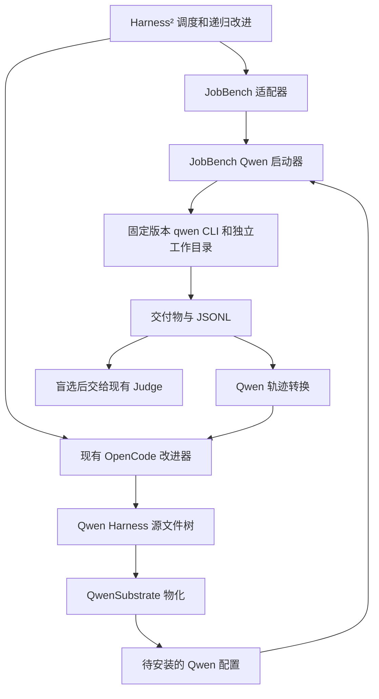

# Qwen Code 执行器接入设计

[English](qwen-code.md)

状态：实验性实现已提供，真实 Linux JobBench 验收仍待完成。设计日期：2026-10-20，更新日期：2026-10-21。Harness² 基线提交：`1cfe254e8d25b15f37048c3730134686abe60335`。

实现说明：固定 npm 发布包的 CLI 已通过本地模拟模型测试，覆盖技能/辅助脚本、Hook 拒绝/反馈、JobBench 产物回收与恢复。采用 JobBench 目录结构的确定性测试任务覆盖两种递归模式的 k=1/2、预算、选择、反思及经验库复用。这些属于兼容性测试，不代表真实 benchmark 结果。运行策略支持有意限制为空配置或仅含 UI/遥测的严格 JSON 系统配置；显式策略路径必须为绝对路径。启动器初始化不带模板的空 Git 项目，阻止上级目录上下文发现；技能 frontmatter 限定为 name/description。用法见[安装指南](../SETUP.md#qwen-code-executor-experimental)。

## 1. 决策与已有证据

生成的 `.qwen/.env` 用于终止上级目录的 dotenv 搜索，与 Git 上下文边界分别处理。旧版 home dotenv 文件含有配置时，预检会失败。运行目录、MCP 审批和信任路径在启动前绑定到本次尝试的独立 home，个人文件不进入安装内容。

新增 `--substrate qw`，将 Qwen Code 接为任务执行器。首版支持 JobBench，保留现有 OpenCode 改进通道，沿用递归改进算法、盲选、反思、评分以及经验库语义。

首版开放 c1–c4、c6、c7，以及受限的 c8。c5 子 Agent 延后。LAB、WorkBuddy、Qwen 改进通道、OAuth、ACP/Daemon 接入，以及 OpenCode 插件的通用兼容能力，分别作为后续工作。

当前证据：

| 项目 | 已观察结果 | 证据边界 |
|---|---|---|
| 本地测试集 | Python 3.12 下全部 16 个测试通过：5 个现有工作流测试、9 个 Qwen 行为测试、2 个需显式启用的发布包 CLI 测试 | 本地执行与模拟模型；真实 Linux/模型验收仍待完成 |
| 发布包 `@qwen-code/qwen-code@0.25.3` | 按固定完整性值安装；加载记忆、追加指令及技能/辅助脚本；覆盖 Hook 拒绝/反馈、工具结果回传、交付物和适配器恢复 | CLI 为真实进程，OpenAI 端点为本地模拟服务；尚未证明 benchmark 分数提升 |
| Qwen 源码 | 已核对 `e715a1af9ecd2aad4543b63d8bb2dd335e31ca04` 的 CLI 和配置契约 | 运行支持绑定到已测试的 npm 包，其他 CLI 构建需分别验证 |

本地验证覆盖最终失败、Hook 阻断、隔离和进程清理；Linux 部署与付费模型执行仍属于待完成验收。

## 2. 职责边界



| 归属 | 职责 |
|---|---|
| 方法层 | 提案、探测和合成预算；选择、反思；只读取此前任务的经验库 |
| `QwenSubstrate` | 可编辑范围、配置物化、启动参数和环境、协议解析、执行器预检 |
| JobBench 适配器/启动器 | 任务输入、工作目录、任务提示、时限、输出回收和完成状态校验 |
| 部署环境 | 固定 CLI/Node、端点凭据、生效的系统策略和网络配置 |
| Judge | 选择结束后按现有规则评分；评分结论不进入改进上下文 |

复用现有 `Substrate` 协议，由 benchmark 提供具体启动器。此次接入不增加全局执行器注册框架，也不改变递归算法。

## 3. 可编辑 Harness 与安装映射

### 源文件树

```text
systemprompt.md
guardrails.md
LongTermMEMORY.md
tool_descriptions/tool_guidance.md
.qwen/skills/<name>/SKILL.md
.qwen/skills/<name>/scripts/<helper>
scripts/<name>.py
.qwen/hooks.json
```

首版不开放 `sub_agents/<name>/AGENT.md`。通过 `BenchSpec.allow_subagents=False` 拒绝相关提案，启动器同时禁用委派工具。

拟新增的 `QWEN_SURFACE`：

| 字段 | 取值 |
|---|---|
| `name` | `qwen`；执行器的命名空间标记另用 `qw` |
| `always_on` | 上述四个 Markdown 文件，顺序与目录树一致 |
| `always_on_max` | 四个文件及拼接分隔符合计 24,000 字符；这是 Harness 预算，不代表 Qwen 上下文窗口上限 |
| `skill_dir` / `skill_name_rule` | `.qwen/skills` / `must_match` |
| `autotrigger_file` | `guardrails.md` |
| `trigger_line` | `- When {desc}, use the skill tool to load {name}.` |
| `plugin_dir` | `None` |
| `hooks_file` / `hook_events` | `.qwen/hooks.json` / `PreToolUse`、`PostToolUse` |
| `compile_skill_scripts` | `True` |
| 安装模式 | 新增 `qwen_root` |

首个 JobBench 基础 Harness 只保留最小指令：遵循任务要求，将最终交付物写入指定输出目录；其余常驻文件为空，不额外添加技能、脚本或 Hook。沿用现有 LAB 基础 Harness 的方式，在实际需要时生成确定性的源文件树。Dry-run 不生成这些文件。

### 原生配置映射

| 组件 | 安装方式 |
|---|---|
| c1 `systemprompt.md` | 生成 `.harness2/append-system-prompt.md`，启动时读取正文传给 `--append-system-prompt` |
| c2 规则、c3 记忆、c4 工具指导 | 按固定标题和顺序合成为根目录 `QWEN.md` |
| c6 技能与技能辅助脚本 | 复制到 `.qwen/skills/`，显式启用源文件树中的技能名称 |
| c7 脚本 | 复制到 `scripts/` |
| c8 命令 Hook | 校验 `.qwen/hooks.json`，仅将其中的 `hooks` 对象合入生成的 `.qwen/settings.json` |

保留 Qwen 内置提示词。首版的 `systemprompt.md` 采用补充指令语义，与 JobBench 的 OpenCode 基础 Harness 追加指令的方式一致。通过 `--system-prompt` 或 `QWEN_SYSTEM_MD` 完全替换提示词不纳入首版。Qwen 源文件不进行隐式模板变量替换。

生成的 `QWEN.md`、`.qwen/settings.json`、追加提示词文件以及安装清单，均不属于可编辑源路径。凭据、模型、工具限制、信任和时限由启动器提供，不在提案的配置接口中开放。这一接口限制不意味着任意提案脚本构成安全边界。`Install.fingerprint` 继续对源文件树计算指纹，排除生成文件。

在源文件树和运行配置固定时，物化结果必须确定。安装清单记录运行配置版本以及生成内容摘要，不包含凭据或临时绝对路径。渲染规则或固定默认值变化时，升级运行配置版本。

### 校验与改进器提示模板

复用现有路径检查、Python 编译、技能名称/描述/触发指令，以及 Hook 外层结构校验。在 `QwenSubstrate.materialise` 中增加 Qwen 专用校验，`JobBenchAdapter.validate_tree` 同样调用该校验，使无效提案能在执行前收到反馈。

c8 首版只接受 `command` Hook。允许事件匹配项，以及 `type`、`command`、`timeout` 字段；拒绝额外的顶层配置、其他 Hook 类型和异步 Hook。未填写超时时使用 10 秒，显式值限定为 1 至 60 秒。命令匹配真实 Qwen 工具名，例如 `write_file`、`run_shell_command`。整个执行仍受统一时限约束。

观察到 PostToolUse 执行，尚不足以证明阻断语义正确。在对固定发布包完成真实 CLI 的 PreToolUse 拒绝与 PostToolUse 反馈测试前，不宣称 c8 已支持。Hook 依赖的脚本必须作为可编辑脚本随 Harness 一起提供，不能依赖作者机器上的文件。

在 `core/prompts.py` 中增加独立的 `qwen` 项，包括现有 `adapt`、`tts` 两套提示模板说明。编辑指令必须准确描述文件路径、追加提示词语义、真实技能调用方式、支持的 Hook 事件以及未开放的 c5。直接复用 Codex/OpenCode 的描述，会让改进器生成错误格式。

## 4. 运行配置

### 配置项

| 拟新增或沿用的配置 | 含义 |
|---|---|
| `HARNESS2_QWEN_MODEL` | Qwen 执行端点接受的准确模型 ID，原样传递，包括可能存在的斜杠 |
| `HARNESS2_QWEN_BASE_URL` | 显式指定 OpenAI Chat Completions 基础 URL，包含所需 API 路径 |
| `HARNESS2_QWEN_API_KEY` | 执行器凭据，只通过子进程环境中的 `OPENAI_API_KEY` 传递 |
| `HARNESS2_IMPROVER_MODEL` | 沿用 OpenCode 的 `provider/model` ID；未配置 OpenCode 执行模型作为默认值时，必须显式填写 |
| `HARNESS2_JUDGE_MODEL` 及现有 Judge 配置 | 保持不变 |
| `HARNESS2_RUNS_DIR` | 沿用现有实验输出根目录 |

不从 OpenCode/Codex 配置或用户的 Qwen 安装中隐式推导模型与凭据。校验 HTTP(S) URL，拒绝 userinfo、查询参数和 fragment，避免凭据进入实验身份或日志。启动时使用的规范化 URL 必须与记录的 URL 完全一致。

`harness2-setup jb --substrate qw` 将 `@qwen-code/qwen-code@0.25.3` 安装到 `dependencies/qwen/`，记录包完整性值。要求 Node >=22，只运行这份本地安装，不能随 PATH 选用全局 `qwen`。改进器仍使用 OpenCode，因此保留现有 OpenCode 安装流程。

### 启动契约

以下以参数列表启动子进程，不拼接 shell 命令：

```text
<local-qwen> --auth-type openai
  --model <HARNESS2_QWEN_MODEL>
  --openai-base-url <HARNESS2_QWEN_BASE_URL>
  --append-system-prompt <rendered c1 text>
  --output-format stream-json
  --approval-mode yolo
  --chat-recording=false
  --max-wall-time <rollout timeout>
  --sandbox=false
  --exclude-tools <fixed excluded tools>
```

通过 stdin 写入任务提示，写完后关闭 stdin。c1 为空时省略追加参数。不启用部分消息输出、`--continue`、`--resume`、`--bare` 或 `--safe-mode`；bare/safe 模式会关闭正在测量的 Harness。发布包的准确参数语法和 stdin 行为必须经过测试。

每次尝试使用新的工作目录，以及位于仓库和任务输入之外的独立 `QWEN_HOME`。初始化不带模板的空 Git 项目，阻止上级目录上下文发现。生成最小用户配置、`trustedFolders.json` 中仅对应本次工作目录的信任项，以及项目配置。启用目录信任，只信任生成的这个工作目录。通过 `skills.disabledLevels` 跳过用户、内置和扩展技能发现，保留项目技能发现，并在 `skills.enabled` 中显式列出已安装技能。

固定首版工具范围：禁用委派/控制工具（`agent`、`list_agents`、`send_message`、`task_stop`）、调度工具（`cron_create`、`cron_delete`、`cron_list`、`loop_wakeup`、`monitor`）、Goal 工具（`get_goal`、`update_goal`）以及 worktree 生命周期工具（`enter_worktree`、`exit_worktree`）。保留普通文件、Shell、搜索和技能工具。需要通过固定 CLI 的工具注册/权限层验证禁用确实生效，包括延迟工具查找；将禁用列表写入实验身份。

显式构造子进程环境。保留必要的操作系统/运行时变量、受控 PATH，以及部署环境指定的策略；清除继承的 provider 选择、提示词覆盖、Qwen 运行目录/信任路径覆盖和额外发现路径。仅绑定选定凭据与本次 `QWEN_HOME`，不复制个人 OAuth Token、扩展、MCP 配置或用户设置。

遵循部署环境的系统设置及其指定的策略路径。不能为了跑通 benchmark 而将系统策略替换为空文件。在首次付费调用前，检查生效策略是否允许生成的上下文、技能、Hook 与必要工具；冲突时指出配置来源并停止。记录不含秘密的策略身份。独立 home 本身不能证明策略隔离，还需通过上级目录/全局上下文的标记测试确认。

此配置沿用仓库现有的无人值守、关闭 sandbox 的执行模式。独立目录隔离实验状态，不构成文件系统或网络安全边界。网络限制单独沿用现有 benchmark 出网策略。

## 5. JobBench 执行与产物

适配器保留任务发现、职业分类、泄漏路径过滤、任务提示、文件提取、评分和报告逻辑，在模型、时限、基础 Harness、启动器和预检选择中增加显式 `qw` 分支。不支持的 `(lab, qw)` 或 `(wb, qw)` 必须在安装、启动子进程或调用模型前报错，不能落入 Codex 的默认分支。

首个启动器与现有 JobBench 适配器一样，每次处理一个任务/运行 ID。适配器在当前进程内调用新增的第一方 runner 辅助函数，由它直接持有 Qwen 的 `Popen`。不要先套用现有 detached shell runner，再让 Qwen 创建另一个独立进程组；只杀死外层 runner 可能遗留真正的执行器。

1. 新建一次尝试，仅复制干净的 `task_folder/` 输入与待安装配置，不带入评分标准、参考答案或之前的输出。
2. 沿用现有 JobBench 任务提示契约，替换为此次工作目录的输入和输出路径。
3. 在新的进程会话中启动 CLI，分别采集 stdout JSONL 与 stderr。
4. 解析最终状态、回收输出；在删除临时工作目录/home 之前，保存轨迹与状态。
5. 只有满足下述完成条件才返回；随后由适配器原子写入现有完成标记。

保留现有存储结构：

```text
runs/jb/dataset/<profession>/<task>/task_folder/
runs/jb/dataset/<profession>/<task>/model_output/<label>/...
runs/jb/dataset/<profession>/<task>/model_traj/<label>/
    qwen-output.jsonl
    qwen-stderr.txt
    qwen-status.json
    .adapt_complete
```

`model_output` 只保存最终交付物。诊断文件和配置清单不能被当成交付物，也不能作为任务答案交给 Judge。`qwen-status.json` 记录协议/运行配置版本、进程退出、最终结果、超时原因、耗时、工具调用校验，以及 provider 可提供的用量信息；在 `install` 字段保存脱敏后的安装清单，避免随工作目录清理而丢失。缺失的美元成本保持未知，现有 ledger 不能被描述为完整的执行器账单。

### 完成与中断

```text
PREPARED -> RUNNING -> CAPTURED -> COMPLETE
                |          |
                +----------+-> FAILED / TIMED_OUT / CANCELLED (unmarked)
```

JobBench 单次执行同时满足以下条件才算完成：

- 进程在时限内以 0 退出。
- 最终 `result` 明确为 `subtype=success`、`is_error=false`；对话和工具结果可解析，且不存在未结束的工具调用。
- 至少存在一个实际交付文件，且复制成功。
- 轨迹/状态已保存，并可计算复制后输出的指纹。

某次工具出错后，模型修正并最终成功，属于有效执行证据。最终错误、协议损坏/截断、只有启动横幅、部分输出文件，或退出码为 0 但缺失最终成功事件，均不能证明完成。

超时或取消时，对进程组发送 SIGTERM，最多等待 5 秒，再对剩余成员发送 SIGKILL 并回收进程。父进程执行外层时限并预留少量退出时间，Qwen 的 wall-time 参数作为额外约束。保留诊断和部分产物供检查，不写完成标记。测试需覆盖 Hook 子进程和 Shell 后代；进程组控制不保证约束故意脱离进程组的进程。

Qwen runner 模块维护带锁的活动子进程集合和取消事件。子进程进入轮询前注册，回收后才移除；取消后不再允许启动新执行。主线程中 `qw` sweep 的作用域在 SIGINT/SIGTERM 或异常退出时，取消并回收自己持有的 Qwen 进程组，恢复原信号处理器，并返回非零中断状态。该逻辑负责 Qwen 执行的清理，不重新设计其他改进通道的进程管理。

启动器不自动重试。失败运行保持无完成标记，沿用现有重跑/恢复流程，重新建立一次尝试。Harness 变更后不能继续旧 Qwen 会话。重跑前，将此前的轨迹/状态和部分产物移入相邻的 `_failed_attempts/<label>/<attempt>/` 目录，放在当前输出/轨迹路径之外；每个 label 保留最近三次失败尝试。现有清理逻辑不能删掉唯一的失败证据。

## 6. 轨迹契约

逐行解析 JSON 事件，不依赖 JSON 字段顺序。保留原事件顺序和采集内容，容忍无关诊断行并记录解析错误。对话、工具或结果记录中的协议损坏使运行保持未完成。未知的非最终事件保留并作为 Harness 诊断展示；未知的最终 result subtype 视为错误。

| Qwen 事件/内容块 | 统一表示 |
|---|---|
| Assistant `text` | `[ASSISTANT]` |
| 输出的 Assistant `thinking` | `[REASONING]` |
| Assistant `tool_use` | `[ACTION] <name>: <input>` |
| User 消息中的 `tool_result` | 按 `tool_use_id` 关联，转换为 `[OBSERVATION]` 或 `[OBSERVATION ERROR]` |
| 真正的用户任务 | `[USER]` |
| 初始化/配置/system 事件 | `[HARNESS]`，不将上下文或配置误当成任务指令 |
| 最终 `result` | 完成/失败诊断，不重复当成一条 Assistant 回答 |

用工具调用 ID 映射处理并行调用。对重复的最终消息 ID 去重，保留首次出现的位置；不能因为两条消息文字相同就丢弃不同消息。首版不启用部分消息，无需合并增量事件。遵循 `obs_trunc`、`args_trunc`、`max_chars`，显式标记截断，同时保留原始采集记录。

首版解析器与测试数据必须覆盖：已恢复的工具错误、多个工具结果、重复 ID、JSON 字段重排、未知事件和提前 EOF。解析器参与判断执行是否成功，不只是展示辅助函数。

## 7. 恢复、实验身份与凭据

命名空间和经验库变体使用 `qw`，例如 `jb-qw-agg1`、`jb-qw-seq1`。只为 `qw` 扩展 `run_sweep._check_identity`，保持现有 `oc/cx` 的身份 JSON 和恢复行为。

在现有任务划分、seed、改进器和 Judge 字段之外，记录 Qwen 模型、规范化端点、认证类型、安装版本/完整性值、Node 版本、运行配置/协议版本、生效策略指纹、固定工具配置以及基础 Harness 定义身份。不记录密钥、访问令牌、临时路径或整个环境。

调度前使用命名空间身份校验可复用执行和经验库。现有 marker 继续绑定 Harness，并记录输出指纹。在 marker extras 中增加 Qwen 执行身份摘要、已保存轨迹和状态的摘要；即使绕过 sweep 入口直接调用适配器，也必须校验这些信息。缺少这些字段的旧 `qw` 标记视为未完成。模型、端点、包、策略或运行配置变化时，使用独立运行根目录；仅轮换凭据不改变实验身份。

仅由适配器在校验和回收成功后写入 `.adapt_complete`。回读必须满足标记身份匹配、状态有效、轨迹完整、输出一致。轨迹或输出缺失/被修改时重跑；非空日志不能算交付物。

封装层不打印凭据参数，也不序列化凭据环境。保存诊断与错误消息前，脱敏已知凭据值；URL 校验负责避免端点秘密进入记录。凭据不得进入可编辑文件树或改进上下文。这里不额外提供执行器安全 sandbox。

## 8. 安装、预检与预期命令

在共用 CLI 选项和 setup 参数中加入 `qw`，并让 check/run/judge/report 共用 JobBench-only 支持范围检查。Dry-run 不创建输出、不安装工具。

Qwen 预检在不调用模型的情况下，检查本地包版本/完整性、Node、必要参数、URL/密钥存在性，以及生效的配置/信任/工具范围。依据固定版本的优先级和拒绝规则检查相关作用域配置；无法确定效果的配置应拒绝，不能报告就绪。真实 CLI 验收测试负责证明支持的配置确实加载，预检不能虚构不存在的 CLI 配置导出参数。改进器仍使用 OpenCode，因此保留其检查。模型校验按执行器分支：Qwen 实验要求 Qwen 执行模型和有效的 OpenCode 改进模型，不要求额外配置一个没有用途的 OpenCode 执行模型。Judge 要求保持现状。只有实际使用 Vertex 的改进器或 Judge 才要求 Vertex/ADC，不能因为 Qwen 端点本身或未使用的 OpenCode 执行模型配置而增加该要求。

预检只检查离线就绪条件，不能证明端点接受该账户或模型。首次真实请求才发现的认证、配额和模型可用性错误，应让该次执行保持未完成。

以下命令已实现，供 JobBench 实验性使用；真实 Linux 验收仍待完成：

```bash
harness2-setup jb --substrate qw
harness2-check --bench jb --substrate qw
harness2 --bench jb --substrate qw --k 1 --mode parallel \
  --only-domains <installed-profession> --max-tasks 1 --dry-run
harness2 --bench jb --substrate qw --k 1 --mode parallel \
  --only-domains <installed-profession> --max-tasks 1
harness2-judge --bench jb --substrate qw --k 1 --mode parallel --bases
harness2-judge --bench jb --substrate qw --k 1 --mode parallel
harness2-report --bench jb --substrate qw --k 1 --mode parallel
```

首次冒烟只选一个已安装职业：`--max-tasks 1` 是每个职业最多一个任务，不是全局一个。各命令使用相同的 subset/任务划分、seed、模式和预算。保留现有 `R=4k` 次执行、`P=3k` 个改进阶段的预算恒等式；选择、反思、重试和评分继续单独统计。

## 9. 交付计划

| 阶段 | 交付内容 | 完成条件 |
|---|---|---|
| 1a | Qwen 源文件范围、原生配置物化、提示模板、固定安装、轨迹解析 | 固定发布包通过协议和隔离测试 |
| 1b | JobBench 启动器、配置/CLI/预检、实验身份、产物与恢复 | Linux 单职业 JobBench `k=1` 跑通执行/选择/反思/评分/报告，重复运行不新增调用 |
| 2 | LAB 适配器/启动器和文档运行环境映射 | 保持相同失败/恢复保证，文档交付物可提取并评分 |
| 3 | WorkBuddy Harness 适配器、镜像、挂载、容器端点路由与子集 | 各支持子集在真实 benchmark 容器内验收 |
| 4 | Qwen 改进通道；随后独立开放可选 c5 | 提案、选择、反思、缓存和预检全部接入新通道后，才移除 OpenCode 依赖 |

阶段 1a 与 1b 共同构成首个受支持版本。不能因为 Qwen 自带 `agent` 工具就宣称子 Agent 已启用。后续 c5 还需具名 Agent 物化、提示词继承、子轨迹/成本采集，以及取消测试。

首版预计修改：

| 文件 | 改动 |
|---|---|
| 新增 `harness2/substrate/qwen.py`；`substrate/__init__.py` | 文件范围、基础 Harness 定义、渲染/校验、参数/环境、解析和就绪检查 |
| 新增 `harness2/benchmarks/jb_qwen_runner.py`；`benchmarks/jobbench.py` | 独立执行、产物/状态回收、完成判断，以及显式 `qw` 分支 |
| `core/spec.py`；`core/prompts.py` | `qwen_root` 与 Qwen 编辑指令，现有改进通道不变 |
| `config.py`；`install.py`；`preflight.py` | 固定依赖、独立执行模型配置、运行配置与按执行器预检 |
| `cli/_common.py`；`cli/setup.py`；`cli/run_sweep.py` | 执行器组合选项/支持范围校验，以及 Qwen 实验身份 |
| 新增聚焦测试；安装/benchmark/实验文档 | 协议、生命周期、集成测试，以及准确的用法与状态 |

计划不修改 qwen-code 源码。若固定 CLI 无法满足必要契约，先报告准确缺口，再决定是否需要上游改动。

## 10. 验收

先做聚焦的行为测试，再跑现有工作流测试。不能用模拟 subprocess 完全替代真实 CLI 覆盖。

| 层次 | 必须具备的证据 |
|---|---|
| 源文件/物化 | 输出确定；生成文件不改变源指纹；c1 与 c2–c4 路由正确；技能启用；拒绝无效路径/Hook/子 Agent；生成的控制配置不在编辑范围内 |
| 协议 | 动作/结果关联、错误恢复和截断正确；处理重复/未知事件；最终失败、孤立工具结果/调用和 EOF 保持未完成 |
| 真实 CLI + 本地模拟端点 | 固定发布包加载记忆/提示词/技能，实际调用技能与辅助脚本，写交付物、执行命令 Hook、回传工具结果并退出；阻断 Hook 产生约定效果 |
| 隔离/策略 | 自动发现与会话复用不加载另一次尝试的可变 home/会话状态；个人/上级目录标记、无关技能/Hook 未加载；强制系统限制触发清晰的预检失败 |
| 进程生命周期 | 超时、取消、信号退出、HTTP/认证失败、流被杀死或截断都不写完成标记；在有界时间内回收 Shell/Hook 后代 |
| 身份/恢复 | 配置未变时不新增调用；改变 Harness、包、端点、运行配置、策略、轨迹或输出后拒绝复用；失败诊断保留；`oc/cx` 恢复保持不变 |
| 递归集成 | 本地任务 fixture 在两种递归模式下以 `k=1`、`k=2` 保持 `R=4k`/`P=3k`、反思和经验库行为；评分标准/结论标记不进入改进器 |
| 真实 Linux benchmark | 两种模式的单职业 `k=1` 均产生交付文件、轨迹、选择/反思、已评分的基础与采用结果，以及报告；重复运行不重做成功工作 |
| 文档/结论 | 明确未支持组合与拟提供命令；未知执行成本保持未知；单任务冒烟只证明兼容性，不作普遍效果提升结论 |

先在 Qwen 内部比较基础与采用结果，固定模型、改进器、Judge、工具策略、数据集版本和网络策略。跨执行器比较分数时，必须同时报告这些差异。效果提升是实验结果，不是功能接入的验收条件。

### 建议的 Linux 验收流程

使用干净的 Linux 账号、Python 3.12、Node >=22 和固定版本的 CLI。一次性配置 Qwen 执行器、OpenCode 改进器和 Judge，完成安装与预检，再启动付费调用。先在同一台主机运行本地集成测试：

```bash
HARNESS2_TEST_QWEN_CLI=1 python -m unittest discover -s tests -v
```

这组测试使用本地模拟模型端点。真实模型验收仍待执行；下表是建议的验收门槛，不代表已有运行结果。

| 验收关卡 | 每种模式的任务范围 | 预算 | 模式与必须具备的证据 |
|---|---|---|---|
| A：执行与跨任务复用 | 一个已安装职业的两个连续任务 | `k=1` | 分别运行 parallel、sequential；任务 1 产出反思与经验库条目，任务 2 收到此前经验，两任务均交付并评分，随后重跑均跳过 |
| B：递归与选择 | 同一职业的一个任务 | `k=2` | 分别运行 parallel、sequential；检查两个组合阶段、多候选选择成功、反思、评分与恢复 |

`k=1` 时，调度器直接采用唯一的最终候选，不调用模型进行选择。关卡 B 用来覆盖实际候选选择和第二步顺序递归。四个实验分别使用独立输出目录和相同任务顺序 seed。计划内总计 **32 次执行器 rollout、24 个改进阶段**；选择、反思、评分与重试另计。

先用 dry-run 列出已安装任务，选择一个至少包含两个任务的职业。在仓库根目录、已配置的虚拟环境中使用 Bash，逐个运行实验；任何命令失败后先检查原因：

```bash
set -euo pipefail
profession="<installed-profession-with-at-least-two-tasks>"
mode=parallel
k=1
tasks=2
export HARNESS2_RUNS_DIR="$PWD/runs/acceptance-qw-${mode}-k${k}"
cell=(--bench jb --substrate qw --k "$k" --mode "$mode" --seed 7)
stream=(--only-domains "$profession" --max-tasks "$tasks" --workers 1)

harness2 "${cell[@]}" "${stream[@]}" --dry-run
harness2 "${cell[@]}" "${stream[@]}"
harness2-judge "${cell[@]}" --bases
harness2-judge "${cell[@]}"
harness2-report "${cell[@]}" | tee "$HARNESS2_RUNS_DIR/report.txt"
# Repeat exactly; successful tasks must be skipped without new model calls.
harness2 "${cell[@]}" "${stream[@]}"
```

关卡 A 再用 `mode=sequential` 运行一次。关卡 B 使用 `k=2`、`tasks=1`，分别运行两种模式。保持职业、seed 和模型配置一致；修改变量后重新设置输出目录与参数数组。Dry-run 必须显示预期的准确任务数量。Seed 只固定任务顺序，不固定模型采样。

保留一份验收记录，包含命令、仓库/CLI/Node 版本、数据集版本、不含秘密的模型/端点/策略身份、实际有序任务 ID、各关卡结论、日志和产物路径。每个成功实验还需检查：

- 每次执行均有有效成功状态、完整轨迹、交付文件和未损坏的完成标记；每个任务/模式满足 `R=4k`、`P=3k`，没有阶段或选择回退。
- 关卡 A 的第二个任务在 sweep 记录的 `library_entries_before` 中已有此前经验条目，保存的改进上下文引用对应经验库。
- `base_judged.json`、`judged.json` 的预期行均有有效分数。`harness2-report` 只汇总采用结果，baseline 文件需单独对照。未评分执行意味着该关卡未完成。
- 重跑时成功任务均跳过，其交付文件、轨迹/状态和完成标记保持不变；新增 sweep 记录属于预期行为。

任一关卡失败，先定位原因再扩大样本。四个实验通过后，再另开两个职业、每职业三个任务的效果实验，在 Qwen 内做基础/采用结果的配对比较。记录分数变化、完成率、耗时和已知费用；执行器美元费用未知时继续标为未知。这个小样本只用于探索，不能据此宣称普遍提升。

## 参考

- [Harness² 执行器接口](../../harness2/substrate/base.py)、[源文件校验](../../harness2/core/tree.py)、[提示模板注册](../../harness2/core/prompts.py)、[JobBench 适配器](../../harness2/benchmarks/jobbench.py)。
- [Qwen 无交互与提示词契约](https://github.com/QwenLM/qwen-code/blob/e715a1af9ecd2aad4543b63d8bb2dd335e31ca04/docs/users/features/headless.md)、[技能](https://github.com/QwenLM/qwen-code/blob/e715a1af9ecd2aad4543b63d8bb2dd335e31ca04/docs/users/features/skills.md)、[Hook](https://github.com/QwenLM/qwen-code/blob/e715a1af9ecd2aad4543b63d8bb2dd335e31ca04/docs/users/features/hooks.md)、[配置](https://github.com/QwenLM/qwen-code/blob/e715a1af9ecd2aad4543b63d8bb2dd335e31ca04/docs/users/configuration/settings.md)。
- [现有实验与网络策略](../EXPERIMENTS.md)、[Benchmark 指南](../BENCHMARKS.md)、[安装指南](../SETUP.md)。
